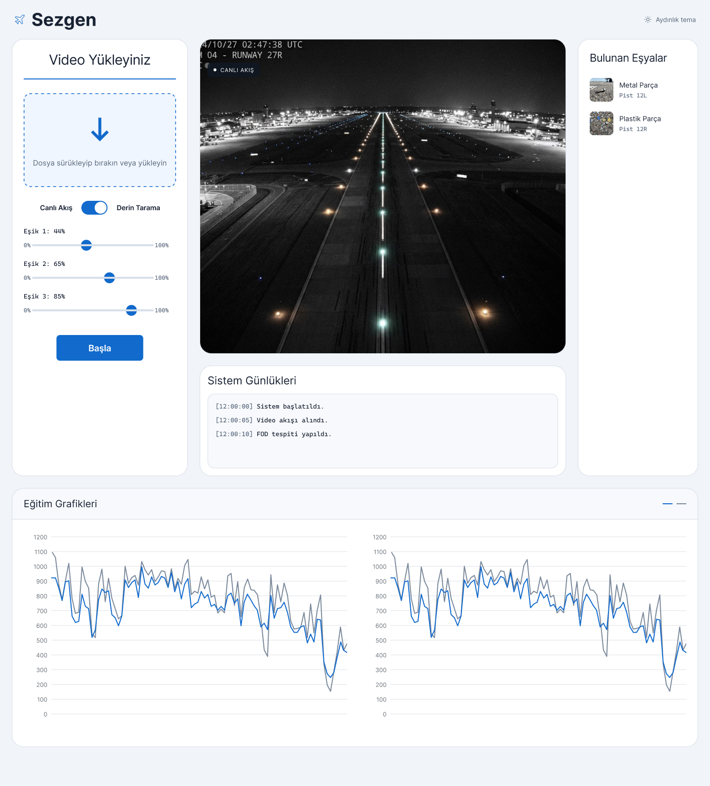
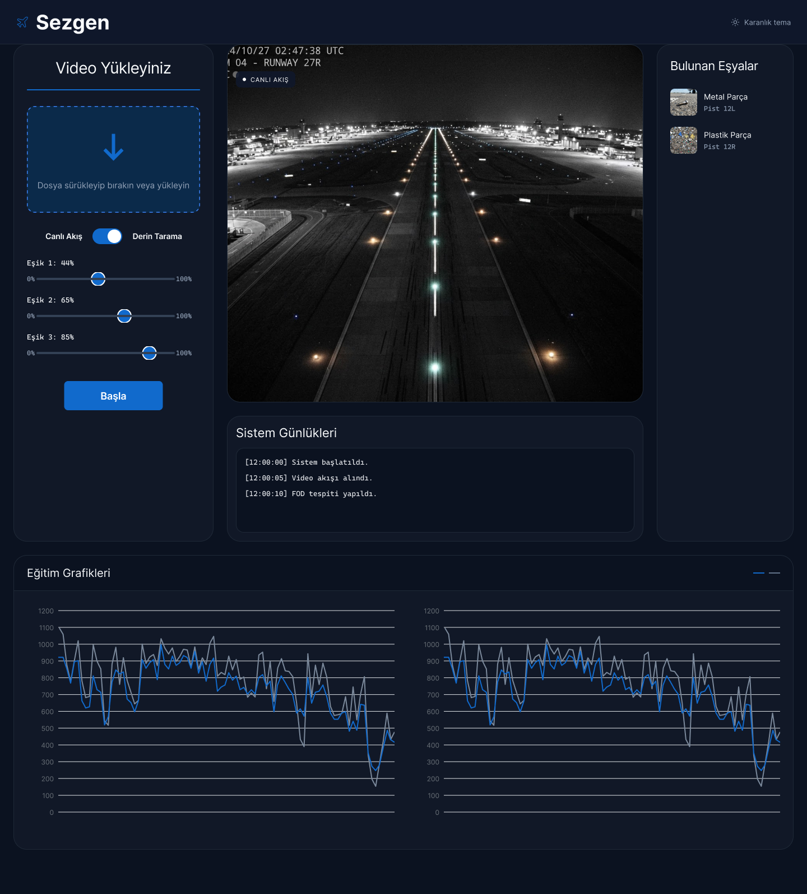

# ✈️ Sezgen — Havalimanı Pistlerinde Yabancı Cisim (FOD) Tespiti Sistemi

**Sezgen**, havalimanı pist ve taksi yollarında unutulan veya düşen küçük metal parçalar, cıvatalar, somunlar, taşlar, plastik atıklar ve tel parçalarını (**Foreign Object Debris - FOD**) gerçek zamanlı kamera akışları veya video kayıtları üzerinden derin öğrenme (**YOLO + SAHI**) ile tespit eden otonom izleme ve alarm sistemidir.

---

## 🖼️ Arayüz Tasarımı (Figma Birebir Uygulama)

Operatör ekranı, uçuş kontrol memurunun dikkatini dağıtmayacak şekilde **Aydınlık Tema** ve **Karanlık Tema** seçenekleriyle tasarlanmıştır:

| Aydınlık Tema | Karanlık Tema |
| :---: | :---: |
|  |  |

---

## 🚀 Temel Özellikler

1. **Çoklu Giriş Kaynağı Desteği:** Sürükle-bırak yerel pist videosu/görseli yükleme, canlı kamera (Webcam/RTSP) akışı ve dahili gece pist simülasyonu.
2. **Çift Tarama Modu (`Canlı Akış` & `Derin Tarama`):**
   - **Canlı Akış:** 25-30+ FPS gerçek zamanlı YOLO çıkarımı.
   - **Derin Tarama (SAHI):** Yüksek çözünürlüklü pist karelerini dilimleyerek (*Slicing Aided Hyper Inference*) milimetrik cıvata, pul ve tel parçalarını yakalama.
3. **Dinamik Eşik Kontrolü:**
   - **Eşik 1 (`44%`):** Güven Eşiği (*Confidence Threshold*)
   - **Eşik 2 (`65%`):** Çakışma Eşiği (*IoU Threshold*)
   - **Eşik 3 (`85%`):** Kritik Alarm Eşiği (*High-Risk Alarm Threshold*)
4. **Anlık Alarm, Bulunan Eşyalar & Sistem Günlükleri:**
   - Tespit edilen her yabancı cismin kırpılmış küçük görseli (*thumbnail*), Türkçe sınıf adı, pist sektörü (`Pist 12L` / `Pist 12R`) ve risk derecesi (**Yüksek / Orta / Düşük**) sağ panelde listelenir.
   - Zaman damgalı olay kayıtları **Sistem Günlükleri** paneline otomatik eklenir ve tek tıkla **CSV** veya **PDF** formatında dışa aktarılır.
5. **Eğitim Grafikleri Paneli:** Model eğitim sürecine ait kayıp (*Loss*) ve doğruluk (*mAP@0.5 / Recall*) eğrilerini çift grafik üzerinde (`models/results.csv` veya varsayılan referans serisi ile) görselleştirir.

---

## 📂 Proje Dizin Yapısı

```text
Sezgen/
├── assets/figma/            # Figma Aydınlık ve Karanlık tema tasarım referansları
├── configs/
│   └── data.yaml            # FOD-A v2.1 (31 sınıf) veri seti yapılandırması
├── models/                  # Eğitilen YOLO ağırlıkları (best.pt / best.onnx / results.csv)
├── notebooks/
│   └── train_colab.ipynb    # YOLO model eğitim Jupyter Notebook dosyası
├── reports/                 # Dışa aktarılan CSV ve PDF FOD tespit raporları
├── src/
│   ├── config.py            # Sistem sabitleri ve varsayılan eşik ayarları
│   ├── detector.py          # YOLO + SAHI (Derin Tarama) çıkarım ve simülasyon motoru
│   ├── exporter.py          # CSV ve PDF rapor üretici
│   ├── risk.py              # 31 FOD sınıfı -> Türkçe etiket, risk seviyesi ve pist eşlemesi
│   ├── voc_to_yolo.py       # FOD-A Pascal VOC (XML) -> YOLO (.txt) dönüştürücü
│   └── web/                 # Figma birebir Web Arayüzü (FastAPI + HTML5/CSS3/JS)
├── Dockerfile               # Konteyner imaj tanımı
├── docker-compose.yml       # CPU ve GPU (NVIDIA CUDA) destekli servis orkestrasyonu
├── main.py                  # Ana web sunucusu başlatıcı (Port 8000)
├── streamlit_app.py         # Alternatif Streamlit arayüzü
└── requirements.txt         # Python bağımlılıkları
```

---

## 🛠️ Kurulum ve Çalıştırma

### 1. Yerel Python Ortamı ile Çalıştırma

```bash
# Sanal ortam oluşturun ve etkinleştirin
python -m venv .venv
.venv\Scripts\activate   # Windows
# source .venv/bin/activate  # Linux / macOS

# Bağımlılıkları yükleyin
pip install -r requirements.txt

# Uygulamayı başlatın (Figma Web Arayüzü)
python main.py
```

Tarayıcınızdan **`http://localhost:8000`** adresine giderek Sezgen Operatör Panelini kullanabilirsiniz.

> **Not:** Eğittiğiniz model tamamlandığında `best.pt` dosyasını `models/best.pt` konumuna kopyalamanız (veya doğrudan arayüzdeki **"Video Yükleyiniz"** kutusuna sürükleyip bırakmanız) yeterlidir; sistem modeli otomatik olarak algılayıp canlı moda geçer.

### 2. Docker ile Çalıştırma

```bash
# Standart (CPU) modunda derle ve başlat
docker compose up --build -d

# NVIDIA GPU (CUDA) hızlandırmalı modda başlatmak için:
docker compose --profile gpu up --build -d
```

Konteyner ayağa kalktığında arayüz **`http://localhost:8000`** adresinde çalışacaktır. `./models` ve `./reports` klasörleri volume olarak bağlandığı için eğitilen `best.pt` ağırlığınızı `models/` klasörüne bıraktığınızda konteyneri yeniden derlemenize gerek kalmaz.
